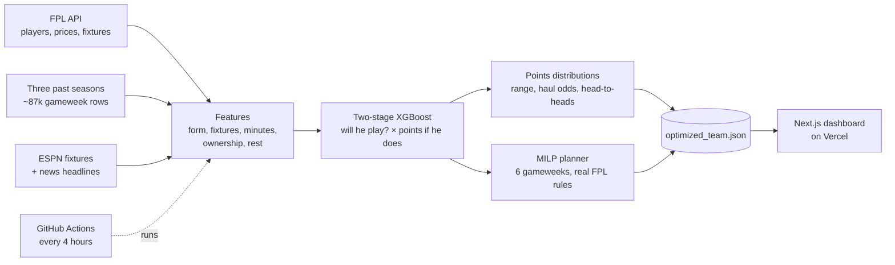

<div align="center">

# VAR-ified XI

**A Fantasy Premier League engine that has to prove every change before it ships.**

It predicts every player's points, plans transfers, lineup and captain six gameweeks ahead under FPL's real rules, and re-plans itself before every deadline.

[**Live dashboard →**](https://var-ified-xi.vercel.app) &nbsp;·&nbsp; [How it works](https://var-ified-xi.vercel.app/how) &nbsp;·&nbsp; [Project handbook](docs/HANDBOOK.md)


-2E8B57?style=flat-square)


</div>

---

## At a glance

| Number | What it means |
|---|---|
| **+15%** | more points per gameweek than picking by recent form — 64.6 vs 57.7 and 61.7 vs 51.9 across two replayed seasons |
| **~87,000** | real gameweek results the model learns from |
| **6 gameweeks** | of transfers, lineups and captains planned at once by a mixed-integer solver |
| **24 studies** | run on the model, 22 of them pre-registered: the pass/fail rule committed before the first result |
| **101 tests** | guarding FPL's rules, both test harnesses, the planner and the team-news reader |
| **$0 a month** | free public data, a free AI model, GitHub Actions and Vercel |

---

## Why I built it

I play FPL in a mini-league with friends, and most "FPL AI" tools stop at sorting players by points per million. That answers the wrong question. The real one is: *given the team I already own, my bank and my free transfers, what should I do this week — and what does that do to the next five weeks?*

So VAR-ified XI is two separate pieces that can't flatter each other: a **model** that predicts points, and a **solver** that makes the decision. And it runs on one rule: **nothing ships because it sounds smart. A change ships when it scores more real points, by more than the noise.**

---

## What it does

- **Makes this week's call** — the transfer (or none), whether a −4 hit is worth it, the starting XI, the bench order and the captain
- **Plans six weeks ahead** under every real rule: £100m budget, 2/5/5/3 squad, legal formations, max three per club, free transfers banked up to five, −4 per extra
- **Thinks in probabilities, not single numbers** — each player's likely range, chance of a haul, and head-to-heads like *"Rogers beats Haaland 52%"*
- **Flags coin flips** — bench players who'd outscore a starter 40–60% of the time, so close calls look close
- **Plans chips** — Triple Captain, Bench Boost and Free Hit valued in every week and placed before they expire
- **Reads your mini-league** — what the managers ahead of you own, and which chips they've already burned
- **Reads team news** — a free AI model reads the week's headlines and has to cite the one behind every call; each call is scored after the gameweek
- **Runs itself** — GitHub Actions checks every four hours, re-plans before each deadline and redeploys the site

---

## How it works



**1 · Data.** Live players, prices, fixtures and match histories come from FPL's public API. Three past seasons come from the open [vaastav archive](https://github.com/vaastav/Fantasy-Premier-League), built through the exact same feature code so training and live rows look alike. Cup, European and international fixtures come from ESPN's public feed, and injury flags are used as FPL published them *before* each deadline.

**2 · Prediction — two models, not one.** Rotation is the biggest source of error in FPL, and a single regressor blurs it into quality: a 2-point projection could be a nailed-on average player or a star who might not play. Those need opposite decisions, so the model is split:

```
Stage 1   minutes classifier   P(didn't play) · P(cameo) · P(60+ mins)
Stage 2   points regressor     E[points | played 60+]

          xP = P(60+) × E[points | 60+]  +  P(cameo) × cameo average for his position
```

Five copies trained on different random seeds are averaged, which lifted agreement between their starting XIs from 75–78% to 86–88% at no cost in points.

**3 · Decision — a solver, not a heuristic.** A PuLP/CBC mixed-integer linear program picks the squad, starting XI, captain and transfers across six gameweeks at once, under every constraint above. The answer is *optimal given the predictions* — not a top-N sort.

**4 · Delivery.** The whole contract between the Python engine and the dashboard is one JSON file. There's no server, database or paid API: GitHub Actions writes the file and commits it, and Vercel redeploys.

---

## How I know it works

### Against the obvious baselines

| | points per gameweek (2024-25 / 2025-26) |
|---|---|
| `naive_form` — no model, each player's last-5 average | 57.7 / 51.9 |
| **This model** (mean of 5 seeds) | **64.6 / 61.7** |
| `hindsight` — optimised on what actually happened, unreachable | 149.0 / 154.6 |

### The noise problem

Changing *nothing* but XGBoost's random seed moves a two-season backtest by up to **175 points**, with accuracy identical to three decimals — the solver turns tiny prediction differences into different squads. My first rule ("score more in every season, on one run") would have passed a change that does nothing **half the time**.

So every comparison now runs on five seeds and reports a paired, block-bootstrapped 95% confidence interval, with the verdict rule written down before the run:

| Verdict | Rule |
|---|---|
| **better** | pooled interval above zero *and* ahead in every season |
| **worse** | pooled interval below zero *and* behind in every season |
| **no detectable effect** | anything else — the harness can't tell, which isn't the same as "rejected" |

Changes are tuned on 2024-25 and 2025-26. Two more seasons, 2022-23 and 2023-24, are **held back**: a change that comes out *better* is run on them once, and ships only if it keeps its sign.

### Selected results

| Change | Result (points, 95% CI) | Verdict |
|---|---|---|
| A model at all, vs last-5 average | **+614** [+361, +876] | ✅ better |
| Ownership as an input (it was silently 0 in training) | **+122** [+26, +216] · held back +65 and +14 | ✅ shipped |
| Cup, European and international matches as inputs | **+87** [+13, +159] · held back +43 and +11 | ✅ shipped |
| Average five models trained on different seeds | XIs agree 86–88% (was 75–78%) · points +25 [−37, +92] | ✅ shipped |
| Train both stages on established starters only | +56 on the tuning seasons, then +18 and −17 held back | ⚠️ not confirmed — stays off |
| Team strength from recent xG instead of FPL's ratings | −153 [−276, −24] in 2025-26 | ❌ worse |

The starters-only result is why the held-back seasons exist: it beat production by 56 points and would have shipped on a looser rule — then it failed to keep its sign on seasons it was never tuned on.

<details>
<summary><b>The full evidence ledger — every experiment, re-measured</b></summary>
<br>

Every verdict below was first decided on **one seed**. The October 2026 audit re-ran the biggest claims on the corrected harness — 5 seeds per season for the backtest, 3 for the simulator — and most of them didn't survive as stated:

| Claim | First measured (1 seed) | Re-measured, pooled 95% CI | Verdict |
|---|---:|---:|---|
| A model at all, vs last-5 average | +19% | **+614** [+361, +876] · +15% | ✅ **better** |
| Hit must gain 8, not 6 | +299 | −1 [−92, +97] | no detectable effect |
| Refit on all data after validating | +127 | +43 [−75, +171] · ahead 8 of 10 seed-seasons | no detectable effect |
| Betting-odds features | −32 | +15 [−82, +107] | no detectable effect |
| Team strength from recent xG instead of FPL's ratings (new) | — | 2025-26 −153 [−276, −24]; 2026-27 replay 267 vs 292 | ❌ worse — last season's FPL ratings stay |
| Count bench players for less than 12% (new) | — | backtest +15 to +25, CIs span zero · simulator −36 [−85, +11] | no detectable effect — stays 12% |
| Average five models trained with different seeds (new) | — | starting XIs agreed between seeds 75–78% → 86–88% in all four seasons; points +25 [−37, +92] · held back +23 [−34, +82] | ✅ **shipped** — steadier picks, no cost |
| Injured/suspended players' later weeks by return dates and measured return curves (new) | — | +4.7 [−26, +33] · changed 11 of 222 decisions | no detectable effect — stays off |
| Projections biased by player type: attackers vs steady defenders, after one missed match, points from one big game (new) | — | +0.02 [−0.43, +0.41] · −0.06 [−0.12, −0.00] · +0.12 [−0.23, +0.51] pts per match | no bias found — nothing to fix |
| Drop price (and ownership) as model inputs (new) | — | −128 [−287, +30] · behind in 10 of 10 runs; with ownership too −99 [−249, +46] | no detectable effect, every run behind — price stays |
| Pull the top projections back toward the position average (new) | — | −1 [−54, +53] · +20 and −21 by season; per position −21 [−78, +40] | no detectable effect — stays off (accuracy a little better, picks barely change) |
| Cup, European and international matches as inputs: rest, rotation, international load (new) | — | +87 [+13, +159] · ahead in both seasons, 9 of 10 runs · held back **+43 and +11** | ✅ **shipped** |
| Form adjusted for opponent strength: schedule strength, adjusted PL form, Elo-weighted cup/European/international form (new) | — | +18 [−65, +99] · +11 [−45, +66] · −17 [−113, +87] | no detectable effect — none used |
| A second model that learns the first one's mistakes (new) | — | 2024-25 −51 [−166, +53], behind in 3 of 4 runs — stopped once it couldn't pass | not used |
| This season's team form added to the ratings (new) | — | −0.2 [−110, +112] · +41 and −41 by season | no detectable effect — not used |
| Real player ages: a live-only bug, not a test. History stores every age as 26, so only this season's rows had real ages and the trees used them to tell players apart (Henderson, 36: 2.4 → 5.1 projected) | — | never in any backtest: age is 26 in every replayed season | 🐞 **fixed**: age off, so live runs match what was tested |
| This season's team form, tested with last season's ratings as live (new) | — | +6 [−118, +123] · +13 and −7 by season · the season's own ratings were worth +107 in 2025-26 | no detectable effect — not used |
| Team ratings from betting odds, with last season's ratings as live (new) | — | +1 [−107, +111] · +4 and −3 by season | no detectable effect — not used |
| Training on stale team ratings, as the live model plays on them (new) | — | −14 [−85, +58] on 2025-26 · stale ratings themselves cost ~93 a season | no detectable effect — not used |
| Early-season tilt toward points per match played (GW1-10) (new) | — | −17.6 [−45, +9] · −11 and −7 by season, 3 of 10 runs | no detectable effect, behind in both — not used |
| Ownership as an input, actually filled in for training (it was 0 everywhere) (new) | — | **+122** [+26, +216] · ahead in both, 8 of 10 runs · held back **+65 and +14** | ✅ **shipped** |
| Club rotation rate as an input (new) | — | −19 [−80, +43] · +12 and −31 by season | no detectable effect — not used |
| Points-if-60+ calibrated to what players at each level really scored (new) | — | −29 [−123, +69] · +6 and −35 by season | no detectable effect — not used |
| Stale ratings replaced by odds-based ratings, as live (new) | — | −28 [−128, +75] · +14 and −42 by season | no detectable effect — not used |
| Form in European, cup and international games, second look (new) | — | stopped at step 1: misses +0.04 [−0.21, +0.29] for players who scored there; strong or weak opponents alike | no signal — not built |
| Split training populations, vs starters-only for both stages | +7 | starters-only **+56** [+11, +103] on the tuning seasons — then +18 and −17 on the held-back seasons | ⚠️ **unconfirmed**: split populations stay |

Not re-measured, and every one of them sits inside the ±146-point band that changing only the seed produces — so treat each as **unproven either way**, not as settled:

| Idea | One-seed result | Reasoning at the time |
|---|---:|---|
| Per-position regressors | −104 | splits the feature set too thin |
| Captain on ceiling instead of mean | −75 | upside-chasing infects the whole squad |
| Early-season shrinkage | −64 | multi-season training covers thin early weeks |
| Set-piece / penalty features | −62 | takers are just good players; already in their xG |
| Recency weighting by season | −58 | lost both seasons |
| Single flat regressor | −53 | smears rotation risk into quality |
| Differential tilt toward unowned players | ≈0 | points-neutral; buys rank variance only |

The re-measurement only means something because the harnesses were fixed first. Each fix was checked for moving totals in the direction it should — a fix that moves them the wrong way points at a bug in the fix:

| Fix | Expected | Measured |
|---|---|---|
| Predict a double-gameweek player per match, not once | more points in double weeks | ✅ +94 and +43, every point of it in the 7 double weeks; +137 [+34, +273] overall |
| Freeze prices at the deadline in multi-week projections | lower simulator totals (the leak flattered them) | ✅ higher with the leak in both seasons for both procedures (+101 and +65 pooled; 7 of 8 seed-seasons) — inside the simulator's noise, so direction only |
| Pre-deadline injury flags | better accuracy | ✅ MAE 1.086 → 0.996 and 0.991 → 0.911; Brier P(60+) 0.097 → 0.089 and 0.084 → 0.079. Points: no detectable effect (−9 [−53, +33]) |
| Each season's own transfer rules | correct counts | unit tests; first-week accrual reproduces a real team |
| Simulator runs production's own decision code | identical live output | identical recommendation before and after |

> FPL's own published xP looked like an obvious extra yardstick, but a squad built from the archived values scores ~99/GW — two thirds of perfect hindsight, which no pre-deadline forecast achieves. Those values are recorded after lineups are known. The comparison was dropped rather than left in looking authoritative.

</details>

### Two harnesses, two questions

| | `backtest.py` | `season_sim.py` |
|---|---|---|
| **Answers** | Are the *predictions* good? | Are the *decisions* good? |
| **Squad** | Rebuilt from scratch weekly, unlimited transfers | One squad carried forward all season |
| **Transfers** | Free and unlimited | That season's real rules — bank cap, top-ups, −4 per extra |
| **Prices** | As they were | Move, with half-the-rise selling |
| **Use for** | Model and feature changes | Anything in the transfer planner |

Both replay seasons week by week, training only on data from *before* the week being predicted, then score the chosen team against what actually happened — autosubs and captain-to-vice fallback included. `season_sim.py` runs **the exact decision code the dashboard runs** (`planner.py`), so any difference between policies is the decision rule and nothing else.

---

## Bugs worth telling

The most useful things this project taught me came from bugs that never crashed anything.

- **The age leak.** FPL's history stores every player's age as 26, so only *live* rows had real ages — and the trees learned to use age to tell players apart. Henderson, 36, jumped from 2.4 to 5.1 projected points. No backtest could ever see it, because every replayed season was all 26s. Age is now off, so live runs match what was tested.
- **The feature that was always zero.** Ownership was a model input, but in training it was 0 on every row, so the model could never learn from it. Filled in properly, it was worth **+122 points**.
- **The harness was playing a different game.** An audit found the backtest banking 2 transfers in seasons that allowed 5, leaking future prices into projections, projecting double-gameweek players once but scoring them twice, and ignoring injury news. Each fix landed behind a test, with the old mode kept so earlier numbers still reproduce exactly.
- **Hundreds of fit players at 0%.** The 2025-26 injury snapshots list many fit players as "available, 0% chance", which quietly zeroed their projections until it was cleaned out.
- **Matches that hadn't happened yet.** Once a gameweek starts, FPL's API reports zero-minute rows for fixtures that haven't kicked off — they read like benchings. Rows now count only once their fixture has finished.
- **A benchmark too good to be true.** FPL's archived expected points built squads scoring two thirds of perfect hindsight, because they're recorded after lineups are known. I dropped the comparison instead of leaving it in looking authoritative.

---

## Engineering

| Workflow | When | What it does |
|---|---|---|
| `weekly.yml` | Every 4 hours | Exits in seconds unless a deadline is within ~30 hours; otherwise fetches, retrains, re-solves, reads the news and commits — which redeploys the site |
| `news-check.yml` | Manual | A one-minute check that the team-news reader works |
| `simulate.yml` | Manual | Runs a season-long policy race in the cloud and posts the result table |

- **Tests.** 101 unit tests cover each season's transfer rules, both harnesses, the planner, chip timing, the deadline gate, Wildcard/Free Hit handling and the news parser.
- **Team news with guardrails.** Within 48 hours of a deadline, Google News and BBC Sport headlines are read by a free Gemini model. A call only counts if it cites a headline that names the player; "out" and "doubt" can lower a projection, while "rotation" stays display-only until it's been right 60% of the time over 30 checked calls.
- **Your chip team.** FPL hides a Wildcard or Free Hit team until the deadline, so `backend/overrides.json` can hold the team you've set; the dashboard shows it and keeps re-checking it, suggesting any change worth a point or more.
- **Run now.** The dashboard can trigger a fresh run through a server-side route with a scoped token, limited to one run at a time, 10 minutes apart and 6 a day.
- **Free by design.** Every dependency is a free tier: FPL's public API, ESPN's public feed, Gemini's free tier in a project with no billing, GitHub Actions and Vercel.

---

## Run it yourself

```bash
git clone https://github.com/Vatsal-cs/var-ified-xi.git
cd var-ified-xi/backend

python3 -m venv venv
source venv/bin/activate          # Windows: venv\Scripts\activate
pip install -r requirements.txt

python main.py                    # best possible squad from scratch
python main.py --team-id 1234567  # a transfer plan for your real FPL team
```

A run takes 5–15 minutes, mostly fetching ~660 player histories, and writes `optimized_team.json` to `backend/data/output/` and `frontend/public/`.

```bash
cd ../frontend
npm install
npm run dev                       # localhost:3000
```

**Deploy for free:** push to GitHub, import the repo into [Vercel](https://vercel.com) with **Root Directory** set to `frontend`, and set `FPL_TEAM_ID` as a repository variable so the scheduled run plans for your team. Add a `GEMINI_API_KEY` secret (free from aistudio.google.com) to turn on team news.

<details>
<summary><b>Testing a change</b></summary>
<br>

```bash
# model / feature changes — five seeds, results kept as JSON
python -m data_engine.backtest --augment --variants production your_variant \
       --seeds 42 7 13 101 2024 --out bt.json

# transfer-planner changes
python -m data_engine.season_sim --augment \
       --policies production your_policy --seeds 42 7 13 --out sim.json

# a planner change, paired: each week the candidate decides from production's
# exact position and both are scored over the next six weeks — weeks where they
# agree count as exactly zero, which cuts out most of the simulator's noise
python -m data_engine.season_sim --augment --policies production \
       --branch production:your_policy --seeds 42 7 13 --out branch.json

# pool any number of result files into one verdict
python -m data_engine.evaluation bt.json more.json --reference production
```

A backtest season takes ~6 minutes per seed; a simulator season 20 minutes to 2 hours. Seasons can run as separate processes and be pooled afterwards.

</details>

---

## Project structure

```
var-ified-xi/
├── backend/
│   ├── main.py                      # entrypoint: fetch → features → model → solver → JSON
│   ├── config.py                    # every rule, weight and switch, with its test result
│   ├── check_deadline.py            # lets the scheduled run exit early
│   ├── wildcard.py                  # is a Wildcard worth it this week, and which squad
│   ├── overrides.json               # your own captain, or a Wildcard/Free Hit team FPL hides
│   ├── data_engine/
│   │   ├── fetch_data.py            # FPL API client
│   │   ├── feature_engineering.py   # rolling form, fixture and player context
│   │   ├── historical_data.py       # past seasons for training
│   │   ├── train_model.py           # the two-stage model
│   │   ├── distributions.py         # full points distributions and head-to-heads
│   │   ├── optimizer.py             # fresh-squad MILP
│   │   ├── transfer_optimizer.py    # six-week transfer MILP
│   │   ├── planner.py               # the weekly decision, shared with the simulator
│   │   ├── chip_planner.py          # best week for each chip
│   │   ├── rules.py                 # each season's transfer rules
│   │   ├── entry_data.py            # your real team, from public endpoints
│   │   ├── rivals.py                # mini-league ownership and chips
│   │   ├── other_matches.py         # cup, European and international fixtures
│   │   ├── team_news.py             # headline reader and its scored record
│   │   ├── backtest.py              # harness 1: prediction quality
│   │   ├── season_sim.py            # harness 2: decision quality
│   │   └── evaluation.py            # multi-seed verdicts with confidence intervals
│   ├── research/                    # one folder per study: pre-registration, code, results
│   └── tests/                       # 101 unit tests
├── frontend/
│   ├── app/                         # This week · Plan & chips · League · Other games · How it works
│   ├── components/                  # pitch, captain odds, coin flips, team news…
│   └── public/optimized_team.json   # written by the backend
└── docs/HANDBOOK.md                 # the full technical write-up
```

---

## Tech stack

| Layer | Tools |
|---|---|
| Data | FPL public API, vaastav archive, ESPN public feed, Google News and BBC Sport headlines |
| Modelling | XGBoost, scikit-learn, pandas, NumPy |
| Optimisation | PuLP with the CBC solver |
| Team news | Gemini (free tier) |
| Frontend | Next.js 16, React 19, TypeScript, Tailwind CSS |
| Infrastructure | GitHub Actions, Vercel |

---

## Honest limits

- **It can't manufacture an 80-point week.** Only 2.1% of player-weeks score 10+. What's achievable is moving the *expectation* from ~52 to ~60.
- **Close start/bench calls really are close.** When two projections differ by under a point, the higher one outscores the other only 52–57% of the time; the edge shows over a season, not every week.
- **Team news comes from headlines, not press conferences**, and can't be backtested — which is why it's judged live and kept on a short leash.
- **The season simulator is noisy.** The same policy finishes 100–240 points apart on different seeds, so it can't resolve planner changes much smaller than ~100 points.
- **Neither harness plays chips**, so both totals sit below a real season. They're yardsticks for comparison, not forecasts.

For the full story — the train/predict window asymmetry, every config knob and the open questions — read the **[project handbook](docs/HANDBOOK.md)**.

---

<div align="center">

Built by [Vatsal Jain](https://github.com/Vatsal-cs) to beat the group chat.

<sub>Not affiliated with the Premier League, Fantasy Premier League or the real VAR. Projections are estimates, not guarantees.</sub>

</div>
